<!-- Generated by `mise run readme` from src/. Edit that, not this. -->

<picture><source media="(max-width: 600px)" srcset="https://github.com/kairosci/kairosci/raw/main/assets/phone/header.svg"></picture>
<a href="https://web.kairosci.dev"><picture><source media="(max-width: 600px)" srcset="https://github.com/kairosci/kairosci/raw/main/assets/phone/header-site.svg"></picture></a>
<picture><source media="(max-width: 600px)" srcset="https://github.com/kairosci/kairosci/raw/main/assets/phone/links.svg"></picture>
<a href="https://web.kairosci.dev"><picture><source media="(max-width: 600px)" srcset="https://github.com/kairosci/kairosci/raw/main/assets/phone/links/1.svg"></picture></a><a href="https://github.com/kairosci"><picture><source media="(max-width: 600px)" srcset="https://github.com/kairosci/kairosci/raw/main/assets/phone/links/2.svg"></picture></a>
<picture><source media="(max-width: 600px)" srcset="https://github.com/kairosci/kairosci/raw/main/assets/phone/stats.svg"></picture>
<picture><source media="(max-width: 600px)" srcset="https://github.com/kairosci/kairosci/raw/main/assets/phone/contribution-city.svg"></picture>
<picture><source media="(max-width: 600px)" srcset="https://github.com/kairosci/kairosci/raw/main/assets/phone/projects.svg"></picture>
<a href="https://github.com/tensorflow/tensorflow"><picture><source media="(max-width: 600px)" srcset="https://github.com/kairosci/kairosci/raw/main/assets/phone/projects/tensorflow.svg"></picture></a><a href="https://github.com/microsoft/vscode"><picture><source media="(max-width: 600px)" srcset="https://github.com/kairosci/kairosci/raw/main/assets/phone/projects/vscode.svg"></picture></a>
<a href="https://github.com/vercel/next.js"><picture><source media="(max-width: 600px)" srcset="https://github.com/kairosci/kairosci/raw/main/assets/phone/projects/next-js.svg"></picture></a><a href="https://github.com/kubernetes/kubernetes"><picture><source media="(max-width: 600px)" srcset="https://github.com/kairosci/kairosci/raw/main/assets/phone/projects/kubernetes.svg"></picture></a>
<a href="https://github.com/nodejs/node"><picture><source media="(max-width: 600px)" srcset="https://github.com/kairosci/kairosci/raw/main/assets/phone/projects/node.svg"></picture></a><a href="https://github.com/microsoft/TypeScript"><picture><source media="(max-width: 600px)" srcset="https://github.com/kairosci/kairosci/raw/main/assets/phone/projects/typescript.svg"></picture></a>
<a href="https://github.com/redis/redis"><picture><source media="(max-width: 600px)" srcset="https://github.com/kairosci/kairosci/raw/main/assets/phone/projects/redis.svg"></picture></a><a href="https://github.com/ansible/ansible"><picture><source media="(max-width: 600px)" srcset="https://github.com/kairosci/kairosci/raw/main/assets/phone/projects/ansible.svg"></picture></a>
<a href="https://github.com/PowerShell/PowerShell"><picture><source media="(max-width: 600px)" srcset="https://github.com/kairosci/kairosci/raw/main/assets/phone/projects/also-powershell.svg"></picture></a><a href="https://github.com/mozilla/pdf.js"><picture><source media="(max-width: 600px)" srcset="https://github.com/kairosci/kairosci/raw/main/assets/phone/projects/also-pdf-js.svg"></picture></a><a href="https://github.com/etcd-io/etcd"><picture><source media="(max-width: 600px)" srcset="https://github.com/kairosci/kairosci/raw/main/assets/phone/projects/also-etcd.svg"></picture></a><a href="https://github.com/omacom/omarchy"><picture><source media="(max-width: 600px)" srcset="https://github.com/kairosci/kairosci/raw/main/assets/phone/projects/also-omarchy.svg"></picture></a>
<a href="https://github.com/georgekobaidze/georgekobaidze"><picture><source media="(max-width: 600px)" srcset="https://github.com/kairosci/kairosci/raw/main/assets/phone/footer.svg"></picture></a>

Regenerated daily by <code>mise run readme</code> (<a href="https://github.com/kairosci/kairosci">source</a>). Console design and contribution city by <a href="https://github.com/georgekobaidze/georgekobaidze">Giorgi Kobaidze</a> (<a href="https://dev.to/georgekobaidze/i-turned-my-github-profile-into-a-cyberpunk-console-with-a-city-built-from-my-contributions-h4c">how he built it</a>), used under MIT.
